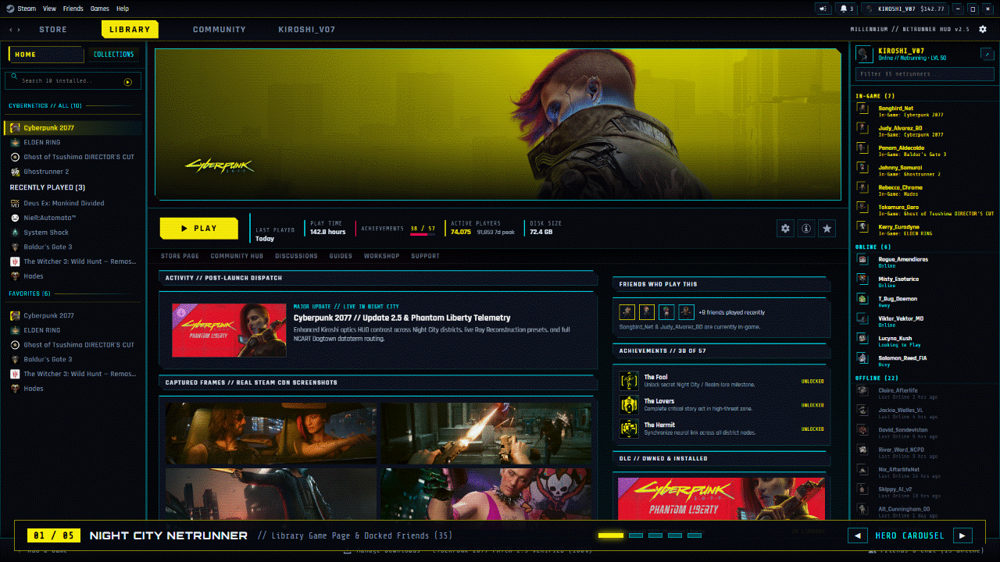
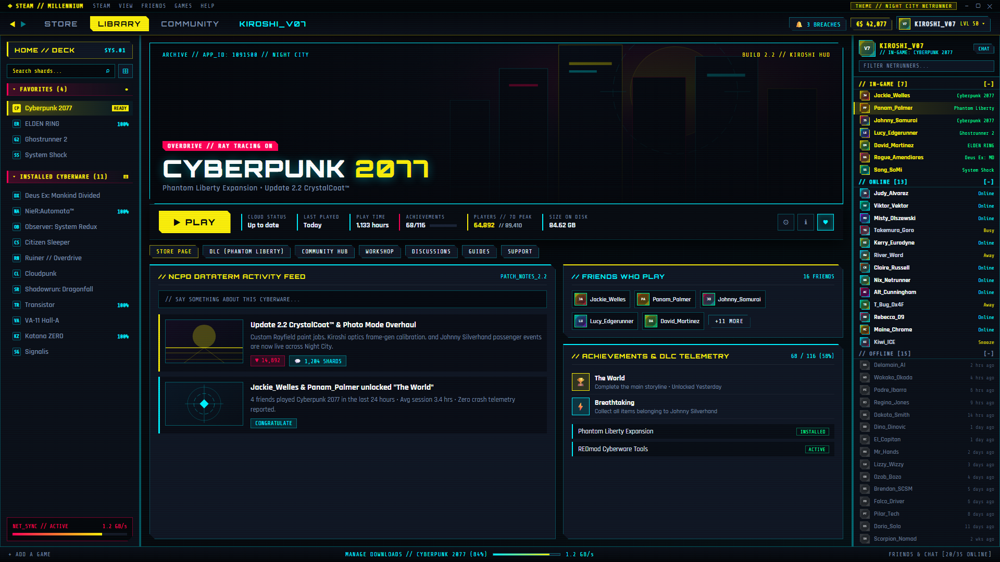
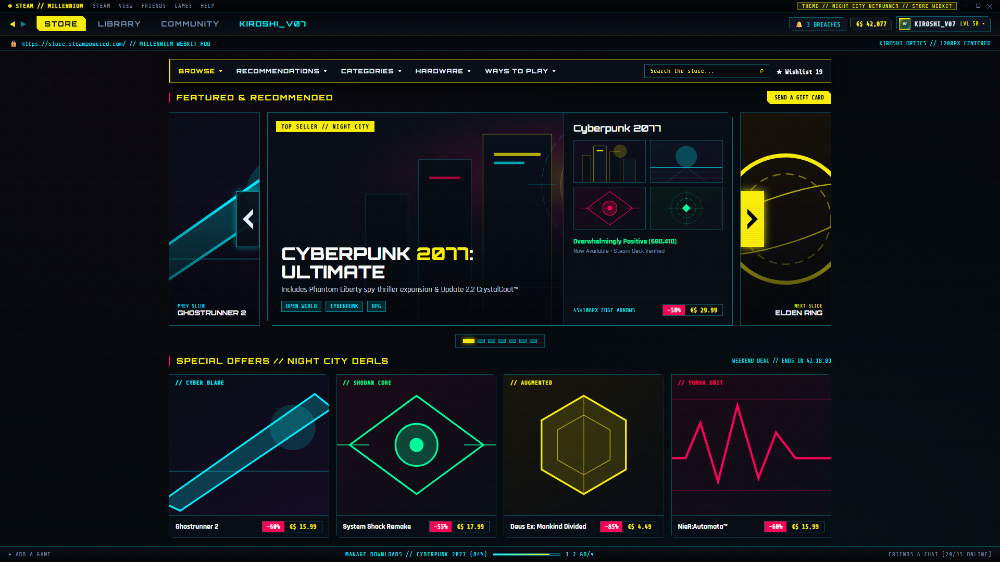
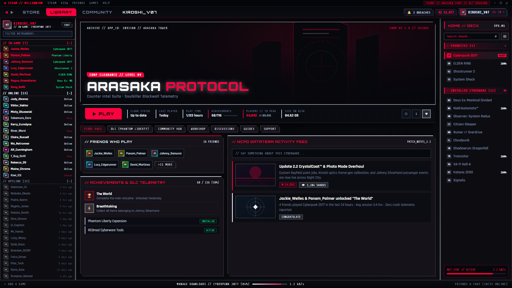
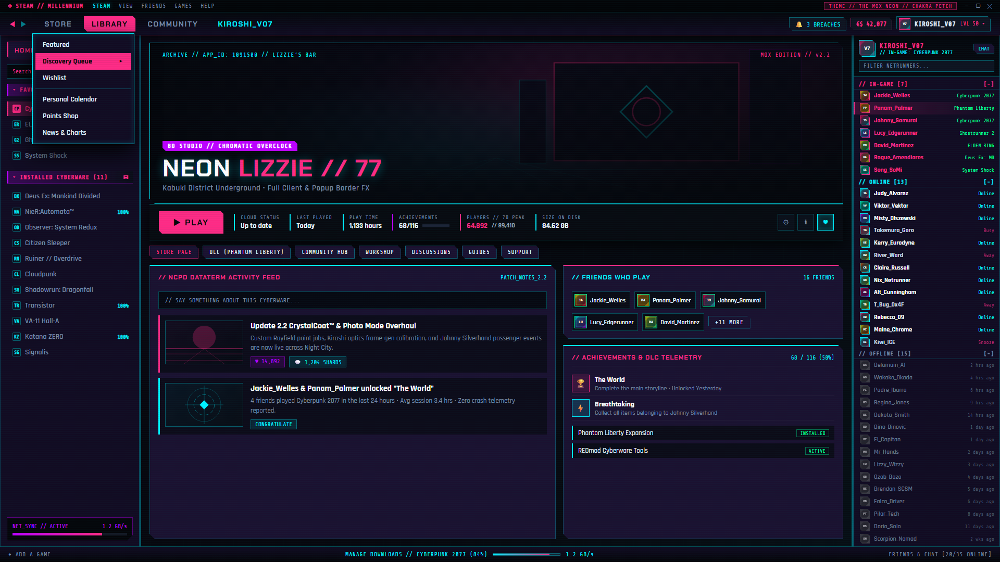
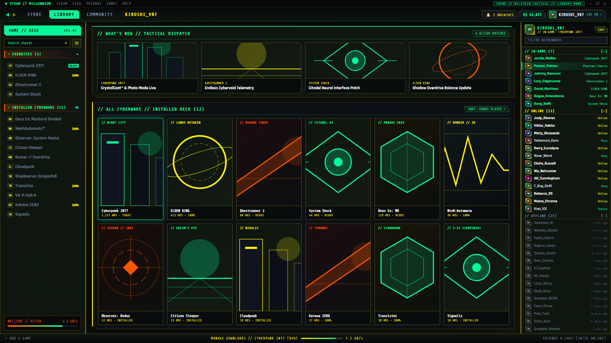

# Cyberpunk 2077 // Night City HUD

**Author:** [RaveAgainstTheMachine](https://github.com/RaveAgainstTheMachine)

A high-contrast Cyberpunk 2077 Kiroshi Optics & Netrunner HUD theme for the Steam Desktop Client, built for [Millennium](https://steambrew.app/).

<p align="center">
  
</p>

<table>
  <tr>
    <td align="center" width="20%">
      <a href="assets/theme-netrunner-library.png">
        
      </a>
      <br /><sub><strong>01 // Night City Netrunner</strong><br />Library &amp; Docked Friends</sub>
    </td>
    <td align="center" width="20%">
      <a href="assets/theme-netrunner-store.png">
        
      </a>
      <br /><sub><strong>02 // Store Hero Carousel</strong><br />WebKit &amp; 45×108px Arrows</sub>
    </td>
    <td align="center" width="20%">
      <a href="assets/theme-arasaka-corp.png">
        
      </a>
      <br /><sub><strong>03 // Arasaka Corp</strong><br />Crimson &amp; Alt Docking</sub>
    </td>
    <td align="center" width="20%">
      <a href="assets/theme-mox-neon.png">
        
      </a>
      <br /><sub><strong>04 // The Mox Neon</strong><br />Magenta HUD &amp; Menus</sub>
    </td>
    <td align="center" width="20%">
      <a href="assets/theme-militech-tactical.png">
        
      </a>
      <br /><sub><strong>05 // Militech Tactical</strong><br />Ops Green &amp; Library Home</sub>
    </td>
  </tr>
</table>

<details>
<summary>Inspect Full-Resolution Theme Previews (1920×1080)</summary>

#### 01 // Night City Netrunner (Default — Library & Docked Friends)


#### 02 // Store Hero Carousel (WebKit Store & 45×108px Edge Arrows)


#### 03 // Arasaka Corp (Corporate Crimson & Alternate Panel Docking)


#### 04 // The Mox Neon (Hot Magenta, Violet & Top Dropdown Menu)


#### 05 // Militech Tactical (Ops Green & Library Home Shelves)


</details>

## Features

- **Full Client UI Skinning** (`libraryroot.custom.css`, `friends.custom.css`): Styled Library home, game pages, shelves, downloads, collections, top navigation bar, context menus, modal dialogs, notifications, and Friends/Chat windows.
- **Store & Community Webkit Skinning** (`webkit.css`): Styled Steam Store & Community pages with dark cyber HUD cards, unified `45x108px` carousel edge arrows adaptively anchored to carousel tracks, pagination indicators, and custom scrollbars.
- **Docked Friends Panel & Telemetry Script** (`libraryroot.custom.js`): Optional docked Friends Panel alongside the main client view plus Game Page play-bar telemetry & layout adjustments.
- **Configurable Layout Conditions** (`skin.json`, `options/`): Switch layout presets directly inside Millennium Settings:
  - **Games Panel Position:** `Left` / `Right`
  - **Friends Panel Position:** `Right` / `Left` / `Hidden`
  - **Gamepage Info & Friends Column:** `Right` / `Left`
- **Included Theme Customizer Studio (CPT)** (`cyberpunk_steam_studio.html`): Standalone browser tool for previewing presets/colors and generating updated theme files.

## Installation

1. Ensure [Millennium](https://steambrew.app/) is installed for Steam.
2. Download or clone this repository into your Steam Millennium themes directory so `skin.json` sits directly inside the theme folder:
   ```text
   <Steam Directory>\millennium\themes\Cyberpunk2077\
   ```
   For default Windows installs:
   ```powershell
   git clone https://github.com/RaveAgainstTheMachine/CyberPunkTheme.git "C:\Program Files (x86)\Steam\millennium\themes\Cyberpunk2077"
   ```
3. Open **Steam Settings -> Millennium -> Themes**, select **Cyberpunk 2077 // Night City HUD**, and reload/restart Steam. (On an open Store tab, press `Ctrl + R` to refresh stylesheets.)

## Repository Structure

```text
Cyberpunk2077/
├── skin.json                     # Millennium theme manifest & settings
├── libraryroot.custom.css        # Main Steam client UI stylesheet
├── libraryroot.custom.js         # Friends dock, resizer & PlayBar helpers
├── friends.custom.css            # Friends list & chat window stylesheet
├── webkit.css                    # Steam Store & Community stylesheet
├── options/                      # Millennium conditional layout stylesheets
│   ├── friends-hidden.css
│   ├── friends-left.css
│   ├── friends-right.css
│   ├── gamepage-info-left.css
│   ├── gamepage-info-right.css
│   ├── games-left.css
│   └── games-right.css
├── cyberpunk_steam_studio.html   # Optional browser-based customizer & code exporter
├── assets/                       # README hero carousel & 1080p theme preview renders
│   ├── hero-carousel.gif
│   ├── theme-netrunner-library.png
│   ├── theme-netrunner-store.png
│   ├── theme-arasaka-corp.png
│   ├── theme-mox-neon.png
│   └── theme-militech-tactical.png
├── LICENSE                       # MIT License
└── README.md
```

## Optional Customizer (`cyberpunk_steam_studio.html`)

Open `cyberpunk_steam_studio.html` in a modern browser (Firefox, Chrome, or Edge) to customize colors, faction presets, and panel defaults, then copy or export the generated `skin.json`, CSS, and JS files.

## License & Disclaimer

Released under the [MIT License](LICENSE).

This is an unofficial fan-made theme and is not affiliated with, endorsed by, or associated with Valve Corporation (Steam) or CD PROJEKT RED (Cyberpunk 2077).
